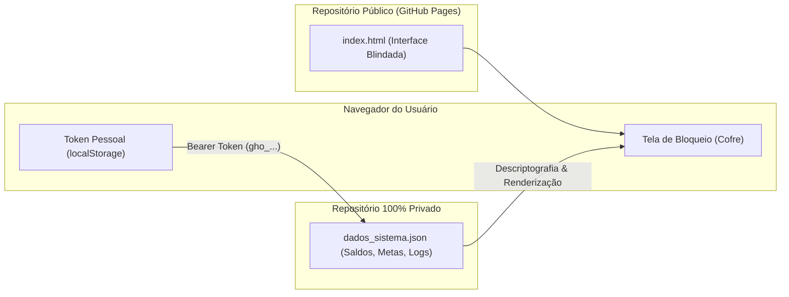

# ⚔️ Sistema Soberano de Patrimônio — Isekai & Solo Leveling Finance Dashboard

<p align="center">
  
  
  
  
  
  
</p>

<p align="center">
  <strong>Transforme sua jornada financeira, metas imobiliárias e investimentos em um RPG de progressão contínua inspirado em sistemas de Isekai e Solo Leveling.</strong>
</p>

<p align="center">
  <a href="https://manuelsilva012-bot.github.io/isekai-financas/"><strong>🌐 Explorar Demonstração Online</strong></a> •
  <a href="#-filosofia-do-sistema">Filosofia</a> •
  <a href="#-módulos-do-dashboard">Módulos</a> •
  <a href="#-arquitetura-do-modo-blindado-segurança">Arquitetura Blindada</a> •
  <a href="#-como-utilizar">Como Utilizar</a>
</p>

---

## 🌌 Filosofia do Sistema

A maioria das pessoas falha em manter a constância financeira porque **planilhas tradicionais são frias, cansativas e não geram dopamina imediata**. Poupar durante anos para uma meta distante (como comprar ou construir uma casa) parece uma maratona sem fim.

O **Sistema Soberano** resolve esse problema aplicando a psicologia dos sistemas de progressão de mangás e romances *Isekai / LitRPG / Solo Leveling*:

* **Micro-Marcos Contínuos:** Cada R\$ 1.000,00 acumulados representam **1 Level Up** no Sistema (`R$ 1,00 = 1 XP`).
* **Habilidades Passivas Desbloqueadas (*Buff Ladder*):** Em vez de olhar apenas para números abstratos de rendimento, o sistema mapeia quais despesas fixas reais da sua vida são permanentemente derrotadas pelos juros passivos (desde pagar o almoço até a prestação inteira da casa).
* **Equipamentos & Tetos de Mana:** Gerenciamento cirúrgico de múltiplos bolsos bancários (contas remuneradas, CDBs com FGC e promoções com limites de teto de CDI).
* **Alertas de Debuff:** Detecção automática de saldo ocioso rendendo em faixas desvantajosas, com botão de expurgo instantâneo.
* **Oráculo de Arbitragem Matemática:** Simulador em tempo real comparando o Custo Efetivo Total (CET + TR + Seguros) de financiamentos imobiliários contra o rendimento líquido da renda fixa, integrando diretamente com a API oficial do Banco Central.

---

## 🖥️ Demonstração Visual da Interface

A interface adota a estética de **Janela de Status Holográfica**:
* **Paleta:** Fundo escuro profundo (`#090d16`), com iluminação neon ciano (`#06b6d4`), dourado tático e esmeralda.
* **Componentes:** Barra de XP animada, ticker em tempo real de geração de rendimento passivo por dia útil e hora, cards chanfrados e modais translúcidos com efeito de vidro (*glassmorphism*).

```
╔════════════════════════════════════════════════════════════════════════╗
║ [ STATUS DO JOGADOR ]                                      [ NÍVEL 47 ] ║
║ Ouro Total: R$ 47.654,80 • Renda Passiva: +R$ 481,22 / mês (114% CDI)  ║
║ XP: [████████████████████████████░░░░░░░░] 654,80 / 1.000,00 XP (65,5%)║
╚════════════════════════════════════════════════════════════════════════╝
```

---

## 🧭 Módulos do Dashboard

O sistema é dividido em **6 abas estratégicas**:

### 🏆 1. Pequenos Marcos de Valor
* **Escada de Buffs Passivos:** Mapeamento visual das contas da vida real já derrotadas pelos juros (Vale-refeição $\rightarrow$ Anuidade de cartão $\rightarrow$ Plano de saúde $\rightarrow$ Fatura do cartão $\rightarrow$ Parcela inteira da casa).
* **Checkpoints de Curto Prazo:** Metas degrau por degrau de milhar em milhar para alimentar a sensação constante de conquista.
* **Diário de Bordo do Sistema:** Log cronológico de todos os aportes, rendimentos e saltos de nível.

### 🗺️ 2. Main Quests (Conquista Imobiliária)
* **Árvore de Metas da Casa Própria:** Comparativo entre caminhos de aquisição (Imóvel Usado, Terreno + Construção em diferentes metragens e Zona de Autoquitação).
* **Oráculo de Simulação:** Sliders interativos de aporte mensal e taxa CDI que recalculam instantaneamente a previsão exata de conclusão (mês e ano) de cada quest.

### ⚔️ 3. Inventário de Contas & Tetos de CDI
* **Monitor de Tetos Turbo:** Rastreia cada conta e cofrinho (99Pay, Nubank, Mercado Pago, Sofisa Direto), exibindo saldo, taxa promocional e teto máximo de rendimento nobre.
* **Sistema Anti-Debuff:** Identifica valores que ultrapassaram o teto e caíram em faixas de penalidade (ex.: saldo excedente a 80% do CDI), permitindo drenar o excedente para contas de 105% com 1 clique.
* **Raio-X de Garantias:** Divisão clara entre valores sob proteção do FGC (Fundo Garantidor de Créditos) e Títulos Públicos federais.

### ⏳ 4. Marcos de Tempo & Missões Mensais
* **Daily / Monthly Quests:** Checklist de rituais bancários mensais (giros via Pix, validações de relacionamento) para manter as taxas promocionais de 115%, 137% e 140% do CDI ativas.
* **Linha do Tempo de Boss Timers:** Contagem regressiva para eventos críticos (expiração de promoções de fim de ano, datas limites para cancelamento de tarifas e marcos de 13º).
* **Purificação Regressiva de IR:** Acompanhamento dos marcos de tempo do Imposto de Renda regressivo em CDBs de longo prazo (30 dias / 180 dias / 360 dias / 720 dias).

### 📜 5. Pergaminho do Oráculo (Análise Semanal)
* **Diagnóstico Completo da Carteira:** Roteiro tático automático indicando exatamente para onde direcionar o próximo salário.
* **Histórico de Fechamentos:** Registro semana a semana para acompanhar a evolução patrimonial ao longo dos meses.

### ⚖️ 6. Laboratório de Arbitragem (Financiamento MCMV vs. CDI)
* **Simulação com Custos Ocultos Reais:** Calcula a taxa real do financiamento embutindo **Juros Efetivos + TR (Taxa Referencial que zera quando Selic &le; 8,5%) + Seguro MIP + Seguro DFI + Taxas bancárias**.
* **Ponto de Virada (Break-Even):** Identifica em qual patamar da taxa Selic/CDI compensa mais continuar acumulando no CDB versus disparar a amortização no prazo da dívida.
* **Integração BrasilAPI:** Botão de consulta ao vivo da taxa CDI oficial divulgada pelo Banco Central do Brasil.

---

## 🔒 Arquitetura do Modo Blindado (Privacy-First)

Para garantir que o painel pudesse ser hospedado gratuitamente no GitHub Pages sem expor patrimônio, saldos reais ou metas pessoais a terceiros, foi implementado o **Padrão de Cofre Privado (Vault Pattern)**:



* **Repositório Público (`isekai-financas`):** Contém estritamente a aplicação front-end (`index.html`). Não possui valores, nomes reais, cidades ou dados bancários.
* **Repositório Privado (`isekai-cofre-privado`):** Repositório protegido (`private: true`) onde reside o banco de dados JSON (`dados_sistema.json`).
* **Autenticação Direta pelo Navegador:** O navegador do usuário utiliza um Personal Access Token pessoal do GitHub salvo de forma isolada no `localStorage` do dispositivo para ler e salvar atualizações diretamente via REST API do GitHub.
* **Para qualquer visitante externo:** A tela permanece bloqueada e ilegível (`🔒 Cofre Trancado`), garantindo 100% de privacidade patrimonial.

---

## 🚀 Como Utilizar / Criar Seu Próprio Sistema

Você pode utilizar este projeto como base para o seu próprio painel de gamificação financeira:

### 1. Clonar ou Fazer um Fork
```bash
git clone https://github.com/manuelsilva012-bot/isekai-financas.git
cd isekai-financas
```

### 2. Executar Localmente (Modo Offline)
O projeto acompanha um servidor Python ultraleve que salva as alterações direto no disco:
```bash
python server.py
# Acesse em: http://localhost:8090
```

### 3. Sincronizar com a Nuvem (GitHub Pages + Cofre Privado)
Utilize o script de utilitário incluso:
```bash
# Publicar alterações da interface e do cofre
python sincronizar_nuvem.py --deploy

# Puxar dados atualizados do cofre
python sincronizar_nuvem.py --pull

# Gerar análise semanal via linha de comando
python sincronizar_nuvem.py --analise
```

---

## 🛠️ Tecnologias Utilizadas

* **Front-end:** HTML5 semântico, JavaScript (ES6+ Vanilla, sem frameworks pesados para carregamento instantâneo no celular).
* **Estilização:** [Tailwind CSS](https://tailwindcss.com/) com paleta customizada, efeitos neon e design responsivo mobile-first.
* **APIs Externas:**
  * [GitHub REST API v3](https://docs.github.com/en/rest) — Sincronização e persistência no cofre privado.
  * [BrasilAPI](https://brasilapi.com.br/) — Consulta em tempo real da Taxa CDI oficial do Banco Central do Brasil.
* **Hospedagem:** GitHub Pages (Zero custo de infraestrutura).

---

## 🤖 Vibe Coding & Co-Criação com Google Gemini Argon

Este projeto é um caso real de **Vibe Coding** levado ao nível de **Engenharia Dirigida por IA (AI-Directed Engineering)**, desenvolvido em colaboração interativa contínua com o modelo **Google Gemini Argon**:

### Isso é considerado Vibe Coding?
* **Sim, na essência da dinâmica:** O conceito de *Vibe Coding* (popularizado por Andrej Karpathy) descreve o ato de programar em que o ser humano não digita código linha por linha, mas atua guiando o fluxo em linguagem natural — definindo a visão estética, o propósito de vida real, o comportamento das regras e as sensações da experiência.
* **Mas vai além do Vibe Coding tradicional ("Casual Coding"):** Muitas vezes o termo é associado a protótipos rápidos e frágeis. Aqui, o processo evoluiu para uma **Engenharia em Parceria com IA**:
  * **O Usuário (Product Lead & Arquiteto Conceitual):** Mapeou o domínio financeiro real (MCMV, Selic, ciclos do Copom, seguros MIP/DFI, TR e a psicologia dos sistemas Isekai) e exigiu a blindagem estrita de privacidade (*Vault Pattern*).
  * **O Gemini Argon (Engenheiro Sênior & Quant):** Converteu cada intenção em código de produção, modelou matematicamente a dinâmica da arbitragem de juros, estruturou a integração REST da GitHub API e implementou automações completas de CI/Deploy e auditoria agendada.

> *"A melhor definição para este fluxo de trabalho é **Engenharia Dirigida por IA (AI-Directed Co-Creation)**: onde a intuição estratégica humana lidera a direção e o modelo de inteligência artificial projeta e executa a infraestrutura de ponta a ponta."*

---

## 📜 Licença

Distribuído sob a licença **MIT**. Veja o arquivo `LICENSE` para mais detalhes.

<p align="center">
  <sub>Desenvolvido com foco em soberania financeira, disciplina e psicologia de progressão.</sub>
</p>
